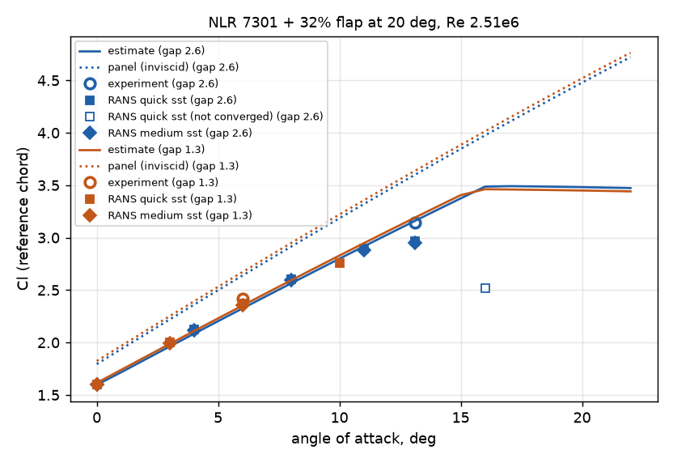
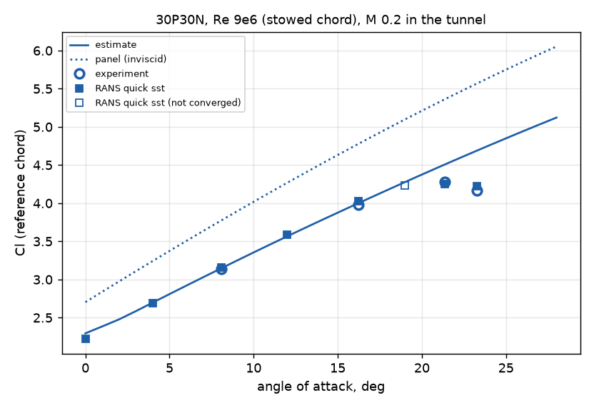
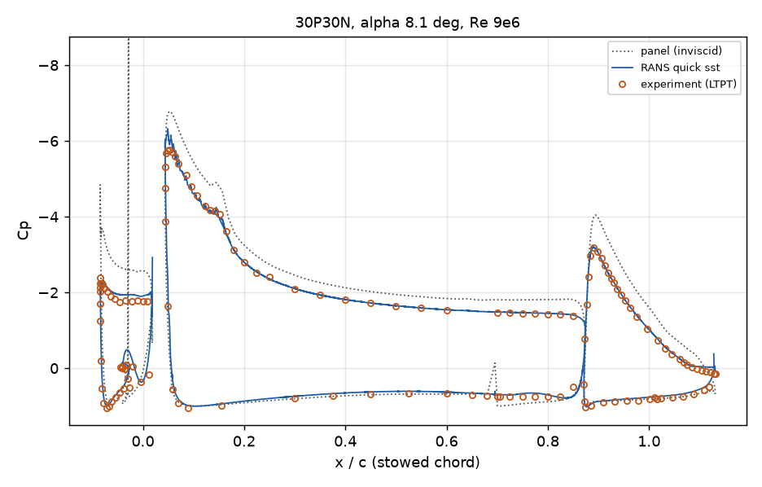
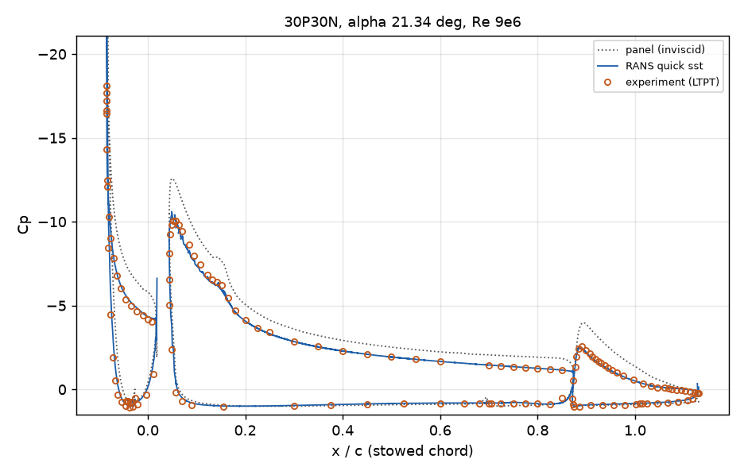

# AeroBench against published multi-element wind-tunnel data

November 2026. RANS at commit e1ba409. Estimate and panel method rerun after the
fixes of 9 November (estimate version 2): trailing edges closed, effective
angles found on the solver, slats, a flap limit that rises with Reynolds number.
Every number here comes from the scripts in this folder; how to rerun them is at
the end.

**Read this first.** Three things below were set using this same data, so they
are not independent checks of it: `SLAT_PEAK_LIMIT` (where a slatted wing
stalls, from 30P30N alone), the 35 degree end of the flap limit (from the
30P30N flap), and nothing else. The lift numbers themselves were not fitted to
either case. The front-element constants were refitted to the engine's own RANS
references only.

## What was compared

Three methods, each run the way the app runs it:

- **Estimate**: `aeroengine.wing.estimate.estimate`, the live result in Wing
  Lab (panel method for the interaction, NeuralFoil for each element).
- **Panel**: `aeroengine.wing.panel`, the inviscid multi-element panel method
  on its own (no boundary layer, no stall).
- **RANS**: `aeroengine.wing.rans.sweep`, SU2 incompressible with the app's
  default model (SST, fully turbulent), its own mesher, `quick` and `medium`
  mesh levels, angles run low to high with each angle restarted from the one
  below, 4000 iterations at most.

All three are incompressible. Both tunnels ran at M 0.185 to 0.2, so on lift
alone the Prandtl-Glauert factor would put the tests about 2% above an
incompressible result; at 30P30N's highest angles the slat peak reaches
Cp -17 (locally supersonic, per NASA TM-112858), which no method here can
represent.

Geometry goes through the same path as an imported section: each element is
re-panelled to 161 points by `airfoils.normalise` and placed by
`geometry.Element` (chord, angle, leading edge). `build.py` prints how far the
re-panelled outline lies from the published one (largest distance, in
reference chords): 30P30N slat 0.0005, main 0.0040 (the cove corners are
rounded off), flap 0.0001; NLR 7301 main 0.0002, flap 0.0002 (gap 2.6%) and
0.0005 (gap 1.3%).

## Sources

### Reproduced

**McDonnell Douglas 30P30N, three elements (slat, main, flap at 30/30 deg).**
- Data and geometry: NASA / AIAA 4th High Lift Prediction Workshop auxiliary
  test case, `AuxTestCase_HLPW4_30p30n_v1.tar.gz` (SHA-256
  9a6e4ae5625eb4a03cdaab22d375effcf3c3b821409daa5b1278d1c16d074127) inside
  https://hlpw4.s3.us-east-1.amazonaws.com/website/Workshop4.zip. The files
  used are copied unchanged into `data/30p30n/` (geometry
  `2010_30p30n_thik_te_18inches.crv.dat`, `clalpha_exp.dat`, `cp_exp.dat`,
  the three READMEs).
- Experiment: NASA Langley LTPT, M 0.2, Re 9 million on the stowed chord,
  corrected angles 8.10, 16.21, 21.34, 23.28 deg. Klausmeyer, S. M. and Lin,
  J. C., "Comparative Results From a CFD Challenge Over a 2D Three-Element
  High-Lift Airfoil", NASA TM-112858, May 1997; Chin, V. D., Peters, D. W.,
  Spaid, F. W. and McGhee, R. J., "Flowfield Measurements About a
  Multi-Element Airfoil at High Reynolds Numbers", AIAA 93-3137, 1993.
- Geometry caveat (from the package): this is the BANC version with a
  thicker slat trailing edge than the LTPT model; otherwise "very close to
  the original". The package itself says the data "should be used only as a
  rough guide" because of three-dimensional effects at high lift.
- Rigging: slat -30 deg, gap 2.95% c, overhang -2.5% c; flap 30 deg, gap
  1.27% c, overhang 0.25% c. Slat chord 15% c, flap 30% c (engine chord
  lines: slat 0.152 c, main 0.832 c, flap 0.300 c).

**NLR 7301 with 32% flap at 20 deg (AGARD AR-138 case A2 / ERCOFTAC UFR 3-01).**
- Geometry: the solid walls of the SAAB FLOWNET structured grids for the
  2.6% and 1.3% gap settings (overlap 5.3% c), archive
  https://kbwiki-images.s3.amazonaws.com/5/5f/UFR3-01_nlr7301grid.zip
  (SHA-256 28aa28b47d981681df3b6300a41a6a9e1c029514ca28cb91bda699b32b7bfc62),
  linked from the ERCOFTAC UFR 3-01 test-case page. `build.py` extracts the
  two wall loops (block sides no other block side shares) into
  `data/nlr7301/nlr7301_gap26.dat` and `nlr7301_gap13.dat`. Both elements
  have finite trailing-edge bases (0.0009 c and 0.0012 c), kept as the gap
  between the outline's two ends.
- Experiment: van den Berg, B. and Oskam, B., "Boundary layer measurements on
  a two-dimensional wing with flap and a comparison with calculations", NLR MP
  79034 U (1979), also AGARD CP-271 and AGARD AR-138 case A2. M 0.185, Re 2.51
  million on the cruise chord (0.57 m chord model); lift from integrated
  pressures with wall corrections, Cl accuracy +/- 0.01, Cd +/- 2%. The two
  data points used, Cl 3.141 / Cd 0.0445 (gap 2.6%, alpha 13.1) and Cl 2.416
  / Cd 0.0229 (gap 1.3%, alpha 6.0), are the experimental row of Table 3 of
  ERCOFTAC UFR 3-01 "Evaluation" (https://kbwiki.ercoftac.org/w/index.php/UFR_3-01_Evaluation),
  which takes them from the EUROVAL / ECARP data (Haase et al. (eds.),
  EUROVAL, Notes on Numerical Fluid Mechanics 42, Vieweg, 1992, as cited by ERCOFTAC). I could not
  get the original AR-138 tables (no open copy found), so no lift curve, no
  Cl max and no surface Cp are compared for this case.
- Measured transition (UFR 3-01, Table 1): main upper surface 2.4 to 4.0% c,
  main lower 64 to 74% c, flap upper surface at x/c 1.063 to 1.081 (about
  55% of the flap chord), flap lower surface laminar throughout. RANS here is
  fully turbulent.

### Looked for and not reproduced

- **Zerihan and Zhang, Tyrrell 026 single element in ground effect**
  (J. Aircraft 37(6), 2000) and **Zhang and Zerihan double element in ground
  effect** ("Aerodynamics of a Double-Element Wing in Ground Effect", AIAA J.
  41(6), 2003). The section coordinates
  are not in the journal papers. They are in Zerihan's PhD thesis
  (University of Southampton, 2001, https://eprints.soton.ac.uk/426058), but
  the repository served a bot-protection page instead of the PDF and I did
  not try to get round it. No other public copy of the coordinates was
  found. **So nothing in this report tests ground effect against
  experiment.** Fetching the thesis by hand would make this the most useful
  next case for a racing user.
- **GA(W)-1 with 29% Fowler flap** (Wentz and Seetharam, NASA CR-2443, 1974,
  https://ntrs.nasa.gov/citations/19750004871). The report tabulates the
  GA(W)-1 and flap coordinates and the flap pivot points, but the main
  element's cove (the main is cut to 96% of the nested chord) is not
  tabulated, and the force data are only in plotted figures. Not reproducible
  without digitising plots and guessing the cove.
- **30P30N JAXA (APC-IV/V, M 0.17, Re 1.71 million)**: open geometry and
  Cp, but the angles are "open-air CFD-equivalent" angles set with SA
  computations, so the data are partly a CFD product; not used.
- **NLR 7301 Texas A&M tests** (van Dam et al., AIAA SciTech 2021,
  NTRS 20210025480): modified, thicker flap whose coordinates are not
  published.

## Headline

| case, point | experiment Cl | estimate | panel | RANS quick (SST) |
|---|---|---|---|---|
| NLR 7301 gap 2.6%, alpha 13.1 | 3.141 | 3.158 (+0.6%) | 3.598 (+14%) | 2.965 (-5.6%) |
| NLR 7301 gap 1.3%, alpha 6.0 | 2.416 | 2.352 (-2.6%) | 2.671 (+11%) | 2.371 (-1.9%) |
| 30P30N, alpha 8.10 | 3.135 | 3.150 (+0.5%) | 3.777 (+20%) | 3.157 (+0.7%) |
| 30P30N, alpha 16.21 | 3.976 | 3.999 (+0.6%) | 4.776 (+20%) | 4.023 (+1.2%) |
| 30P30N, alpha 21.34 (about Cl max) | 4.278 | 4.505 (+5.3%) | 5.360 (+25%) | 4.249 (-0.7%) |
| 30P30N, alpha 23.28 (past Cl max) | 4.170 | 4.690 (+12%), marked separating | 5.570 (+34%) | 4.221 (+1.2%) |

| case, point | experiment Cd | estimate | RANS quick |
|---|---|---|---|
| NLR 7301 gap 2.6%, alpha 13.1 | 0.0445 | 0.0459 (+3%) | 0.0650 (+46%) |
| NLR 7301 gap 1.3%, alpha 6.0 | 0.0229 | 0.0287 (+25%) | 0.0278 (+21%) |

Before the 9 November fixes the 30P30N estimate read 28 to 46% low (2.250,
2.386, 2.322, 2.295) with the slat's lift negative.

Mesh check (NLR gap 2.6%, rising sweep 0 to 13.1 deg): the medium mesh
(89k cells against 48k) moves lift by at most 0.7% (2.950 against 2.965 at
13.1 deg) and drag by up to 2.5%, so the RANS errors above are not a
quick-mesh artefact; they belong to the model (SST, fully turbulent,
incompressible). The NLR gap 1.3% medium-mesh result is in the case table.
No medium-mesh 30P30N run was made (time).

The NLR points are two angles of one model, so they say little about the
spread: an estimate within 3% at both is encouraging, not proof.

## Case 1: NLR 7301 with flap



<!-- tables:nlr -->
#### NLR 7301 gap 2.6

| alpha | Cl exp | Cl estimate (err) | Cl panel (err) | Cl RANS (err) | Cd exp | Cd estimate | Cd RANS |
|---|---|---|---|---|---|---|---|
| 13.1 | 3.141 | 3.158 (+0.6%) | 3.598 (+14.5%) | 1.612 (-48.7%) quick from rest/sst NOT CONVERGED SEPARATED; 2.965 (-5.6%) quick/sst; 2.950 (-6.1%) medium/sst | 0.0445 | 0.0459 (+3%) | 0.4980 quick from rest; 0.0650 quick; 0.0666 medium |

Per element Cl on the reference chord (main, flap):

| alpha | estimate | panel | RANS |
|---|---|---|---|
| 13.1 | 2.795, 0.363 | 3.217, 0.381 | quick from rest: 1.141, 0.471; quick: 2.656, 0.309; medium: 2.642, 0.309 |

Lift curve, NLR 7301 gap 2.6: RANS quick | RANS medium

| alpha | exp | estimate | panel | RANS quick Cl / Cd | RANS medium Cl / Cd |
|---|---|---|---|---|---|
| 0 | - | 1.597 | 1.794 | 1.600 / 0.0191 | 1.598 / 0.0191 |
| 4 | - | 2.083 | 2.359 | 2.122 / 0.0243 | 2.118 / 0.0244 |
| 8 | - | 2.563 | 2.913 | 2.603 / 0.0332 | 2.594 / 0.0335 |
| 11 | - | 2.916 | 3.319 | 2.898 / 0.0451 | 2.881 / 0.0461 |
| 13.1 | 3.141 | 3.158 | 3.598 | 2.965 / 0.0650 | 2.950 / 0.0666 |
| 16 | - | 3.487 | 3.975 | 2.518 / 0.2435 (nc) sep | - |

#### NLR 7301 gap 1.3

| alpha | Cl exp | Cl estimate (err) | Cl panel (err) | Cl RANS (err) | Cd exp | Cd estimate | Cd RANS |
|---|---|---|---|---|---|---|---|
| 6 | 2.416 | 2.352 (-2.7%) | 2.671 (+10.6%) | 2.371 (-1.9%) quick/sst; 2.357 (-2.4%) medium/sst | 0.0229 | 0.0287 (+26%) | 0.0278 quick; 0.0282 medium |

Per element Cl on the reference chord (main, flap):

| alpha | estimate | panel | RANS |
|---|---|---|---|
| 6 | 2.019, 0.333 | 2.324, 0.347 | quick: 2.074, 0.297; medium: 2.062, 0.295 |

Lift curve, NLR 7301 gap 1.3: RANS quick | RANS medium

| alpha | exp | estimate | panel | RANS quick Cl / Cd | RANS medium Cl / Cd |
|---|---|---|---|---|---|
| 0 | - | 1.615 | 1.824 | 1.598 / 0.0189 | 1.600 / 0.0190 |
| 3 | - | 1.986 | 2.250 | 2.001 / 0.0224 | 1.997 / 0.0226 |
| 6 | 2.416 | 2.352 | 2.671 | 2.371 / 0.0278 | 2.357 / 0.0282 |
| 10 | - | 2.829 | 3.220 | 2.757 / 0.0404 | - |

plots: ['30p30n_cl.png', '30p30n_cp_21p34.png', '30p30n_cp_8p1.png', 'nlr7301_cl.png']
<!-- /tables:nlr -->

What it shows:

- **Estimate.** Lift within 0.6% and 2.6% of the two measured points, and its
  lift-curve slope from 0 to 11 deg (about 0.12 per deg) matches RANS (0.118);
  the panel method's is 0.138, so most of what the estimate takes off the
  panel method is the right amount of viscous loss. It has no flag at either
  point, matching attached flow in the test. Drag: within 3% at 13.1 deg and
  25% high at 6 deg (gap 1.3%). The test had long laminar runs (flap upper
  surface laminar to about 55% of its chord, flap lower surface laminar
  throughout); NeuralFoil models transition on each element alone, which is
  closer to that than fully turbulent RANS, but one good and one 25%-off
  drag point is not a drag validation.
- **Panel.** 10 to 14% high, as expected without a boundary layer. Read it
  for trends, never for levels.
- **RANS (quick mesh, SST, fully turbulent).** 2 to 6% low on lift, 21 to
  46% high on drag (fully turbulent on a coarse mesh: the drag excess is
  the expected direction). At 16 deg the quick-mesh run separates and does
  not converge (Cl 2.52 and falling), so RANS puts stall between 13 and
  16 deg; no published Cl max was available to check that. The estimate's
  lift keeps rising past that: the two disagree on Cl max and there is no
  data here to say which is right.
- **RANS started from rest at 13.1 deg** (one angle, no sweep) fell onto a
  stalled, oscillating solution: Cl swinging between about 1.0 and 1.8,
  Cd about 0.5, main element reversed from 5% chord. The engine flagged it
  (not converged, separated), so it was not silent, but the same mesh and
  model give Cl 2.965 attached when the sweep arrives from 11 deg. **A
  single high-angle RANS run from rest is not to be trusted on a highly
  loaded multi-element wing; run the sweep upwards.**

## Case 2: 30P30N three-element







<!-- tables:p30 -->
#### 30P30N

| alpha | Cl exp | Cl estimate (err) | Cl panel (err) | Cl RANS (err) | Cd exp | Cd estimate | Cd RANS |
|---|---|---|---|---|---|---|---|
| 8.1 | 3.135 | 3.150 (+0.5%) | 3.777 (+20.5%) | 3.157 (+0.7%) quick/sst | - | 0.0267 | 0.0411 quick |
| 16.21 | 3.976 | 3.999 (+0.6%) | 4.776 (+20.1%) | 4.023 (+1.2%) quick/sst | - | 0.0264 | 0.0574 quick |
| 21.34 | 4.278 | 4.505 (+5.3%) | 5.360 (+25.3%) | 4.249 (-0.7%) quick/sst | - | 0.0259 | 0.0764 quick |
| 23.28 | 4.170 | 4.690 (+12.5%) | 5.570 (+33.6%) | 4.221 (+1.2%) quick/sst | - | 0.0258 | 0.0885 quick |

Per element Cl on the reference chord (slat, main, flap):

| alpha | estimate | panel | RANS |
|---|---|---|---|
| 8.1 | 0.332, 2.260, 0.557 | 0.348, 2.840, 0.588 | quick: 0.257, 2.442, 0.459 |
| 16.21 | 0.700, 2.797, 0.502 | 0.735, 3.515, 0.526 | quick: 0.604, 3.023, 0.396 |
| 21.34 | 0.985, 3.066, 0.454 | 1.034, 3.853, 0.473 | quick: 0.812, 3.130, 0.308 |
| 23.28 | 1.106, 3.150, 0.434 | 1.161, 3.958, 0.450 | quick: 0.876, 3.079, 0.266 |

Estimate flags at 23.28 deg: Slat's suction peak is 38 below its trailing-edge pressure (Cp) in place, more than the 35 the 30P30N slat held: it separates; 

Lift curve, 30P30N: RANS quick

| alpha | exp | estimate | panel | RANS quick Cl / Cd |
|---|---|---|---|---|
| 0 | - | 2.294 | 2.704 | 2.219 / 0.0322 |
| 4 | - | 2.697 | 3.242 | 2.689 / 0.0357 |
| 8.1 | 3.135 | 3.150 | 3.777 | 3.157 / 0.0411 |
| 12 | - | 3.566 | 4.268 | 3.592 / 0.0478 |
| 16.21 | 3.976 | 3.999 | 4.776 | 4.023 / 0.0574 |
| 19 | - | 4.277 | 5.098 | 4.229 / 0.0716 (nc) |
| 21.34 | 4.278 | 4.505 | 5.360 | 4.249 / 0.0764 |
| 23.28 | 4.170 | 4.690 | 5.570 | 4.221 / 0.0885 |
<!-- /tables:p30 -->

What it shows:

- **RANS** is the standout: lift within 1.2% at all four measured angles,
  including Cl max (4.249 at 21.34 deg against 4.278) and the drop after it
  (4.221 at 23.28 against 4.170), and its surface Cp lies on the measured
  points on all three elements, including the slat suction peak of about
  -17 at 21.34 deg. Two cautions. The package calls the data "a rough guide"
  with known three-dimensional effects at high lift, and the original 1993
  workshop's RANS codes over-predicted lift (NASA TM-112858), so part of
  this agreement can be luck. And the flow is incompressible here while the
  tunnel ran at M 0.2 with a locally supersonic slat peak at high angle.
  Treat it as: on a well-designed high-Re landing configuration, the
  engine's RANS gets lift to within a few percent up to and through Cl max.
  The 19 deg point did not meet the convergence test (Cl still moving by
  0.015 per 100 iterations).
- **Panel** 20 to 33% high, growing with angle because nothing stalls.
- **Estimate**: within 0.6% to 16 deg, 5.3% high at Cl max, and it keeps
  rising past Cl max (it has no model of the lift falling). It marks the wing
  separating at 23.28 deg, at the slat. Per element it is less good than the
  total: up to Cl max, slat 16 to 29% high, flap 21 to 47% high, main 2 to 8%
  low against RANS. Those errors partly cancel.
  - Every row is marked **not trusted**: NeuralFoil's confidence is 0.0 on
    the slat section and 0.43 on the main. That flag is right and stays: the
    viscous correction on those two comes from a network outside its range.
    In the app and the optimiser a slatted wing therefore shows as untrusted,
    and a study fails those trials.
  - Drag (0.026, flat with angle) is **not usable** on a slatted wing. RANS
    gives 0.041 to 0.089 and rises with angle. There is no tunnel drag for
    this case. A slat and the main behind it are held at their stall-onset
    drag with no growth, which cannot show the rise.
  - Stall is one fitted number. `SLAT_PEAK_LIMIT` 35 sits between the slat's
    32.1 at Cl max and 38.0 past it, from this case alone, at Re 9 million.
    Its dependence on Reynolds and Mach number is unknown.
- **The flap limit.** Measured chord line to chord line as the engine does
  (leading edge = point furthest from the trailing edge), the 30P30N flap sits
  34.8 deg past the main, attached. The limit is now 25 deg up to a flap
  Reynolds number of 1.5 x 10^5 (where the engine's RANS set it), rising
  linearly in log Re to 35 deg at 2.7 x 10^6. **Nothing between those two was
  tested**, and a racing flap at 40 m/s (Re about 5 x 10^5) gets about 29 deg
  from that line alone. Confirm such a flap with RANS. Note also that the
  chord-line angle is not the nominal deflection: the NLR flap is "20 deg"
  nominal and 14.1 deg chord line to chord line.

## Ground effect

Not tested against experiment: no case with public coordinates was found
(see Sources). The estimate's ground model (`ground_share` in
`estimate.py`) is fitted to the engine's own RANS, not to a wind tunnel, so
the ride-height trend it gives has no independent validation in this
report.

## Where the numbers can be trusted, and what to do with each

| quantity | estimate (live) | panel | RANS (quick/medium, SST) |
|---|---|---|---|
| Lift, conventional main + flap(s), attached, alpha below about 13 deg | Within 4% on the two NLR points; slope right. Use for design trends and screening. Confirm the final choice with RANS. | 10 to 25% high. Trends only. | Within 2 to 6% (NLR), 1% (30P30N). Use as the number, with a mesh check. |
| Lift with a leading-edge slat | Within 1% to 16 deg, 5% at Cl max, on one case. Marked untrusted (NeuralFoil outside its range). Total only: per-element errors reach 47%. | 20 to 33% high. | Within 1.2% on 30P30N. |
| Cl max and stall angle | No test of its Cl max matched to data here; the NLR run disagrees with RANS on stall by 2 to 5 deg. Treat as unvalidated. | None (no stall). | 30P30N Cl max within 1% and post-stall drop captured; on NLR no data. Needs a rising sweep; one angle from rest can land on a stalled branch. |
| Drag | Main + flap: one point within 3%, one 25% high. Order of magnitude only. Slatted: not usable. | Meaningless. | 21 to 46% high on NLR (fully turbulent, quick mesh). Use for comparing designs at the same settings, not for absolute drag. |
| Surface Cp | Not produced. | Shape right, suction 20 to 30% high. | Matches 30P30N measurements on all three elements. |
| Ground effect | Not validated against any experiment. | Overstates the ground's gain (by the engine's own account). | Not validated against any experiment. |

Caveats that apply to every row: two configurations, six measured points,
both at Re 2.5 to 9 million. The racing use of the app is mostly at Re 0.2
to 1 million and in ground effect, where nothing here applies directly.

## Engine bugs found here, and what became of them

1. **Estimate: a straight-line fit of lift against angle, used far outside its
   range. Fixed.** Effective angles, the front-element lift cap and the viscous
   ratio now come from secant steps on the panel solver. An element alone read
   0.5 deg of upwash at 18 deg; it now reads none. Over a ground the straight
   line stays on purpose: the element's lift alone there rises faster than the
   line (turned toward the ground), and the ground drag and separation are
   fitted to RANS on that reading. The exact curve would move the main 6 deg at
   150 mm and lose the drag calibration, and two RANS points cannot support a
   new one. The front-element constants were refitted on the seven converged
   RANS references (`FRONT_LIFT_LIMIT` 9.25, `FRONT_SEPARATION` 15,
   `DRAG_GROWTH` 0.0076): lift within 3.4%, drag within 9.1%.
2. **Panel method: open blunt trailing edges. Fixed**, in `panel.py` and the
   app's `PanelSolver.swift` (they agree to 1e-10). Each surface moves half the
   gap over the last 20% of chord, as XFOIL's TGAP. NACA 0012 trailing-edge Cp
   goes from -23.8 to +0.54 (the sharp section's 0.53); the 30P30N slat's -395
   goes away. Lift moves under 0.5%, and blend lengths of 5 to 40% of chord move
   it 0.2%. This replaces an earlier note here of -4.5%, which came from moving
   only the end nodes.
3. **No slat in the element model. Fixed in the estimate only.** The main is the
   first element at least half the longest chord; any ahead are slats. The app's
   canvas and menus (`WingIssue.label`), the gap and overlap rules in
   `geometry.py`, and the optimiser still assume element 0 is the main, so a
   slatted wing's estimate says "Slat" where the canvas says "Main".
4. **The 25 deg deflection limit. Now rises with Reynolds number**, see Case 2.
5. **RANS from rest at high angle** (NLR, 13.1 deg) converges to a stalled
   branch where the sweep finds attached flow (Cl 1.6 against 3.0). The run is
   flagged, but a user running one angle would get a wrong, if labelled, answer.
   Not changed.

## How to rerun

From the repository root (the engine's uv environment has NeuralFoil,
matplotlib and SU2 on its path as the app uses them):

```sh
cd engine
# 1. geometry -> data/*/elements.json (pass the ERCOFTAC zip to re-extract the NLR walls)
uv run python ../docs/validation/published/build.py [UFR3-01_nlr7301grid.zip]
# 2. estimate and panel method at 1-degree steps and the published angles -> results_quick.json (seconds)
uv run python ../docs/validation/published/quick.py
# 3. RANS sweeps -> results_rans.json (quick mesh 4 to 15 min per case on 12 cores; medium longer)
uv run python ../docs/validation/published/rans_runs.py /tmp/rans "NLR 7301 gap 2.6" quick sst 0 4 8 11 13.1 16
uv run python ../docs/validation/published/rans_runs.py /tmp/rans "NLR 7301 gap 1.3" quick sst 0 3 6 10
uv run python ../docs/validation/published/rans_runs.py /tmp/rans 30P30N quick sst 0 4 8.1 12 16.21 19 21.34 23.28
uv run python ../docs/validation/published/rans_runs.py /tmp/rans "NLR 7301 gap 2.6" medium sst 0 4 8 11 13.1
uv run python ../docs/validation/published/rans_runs.py /tmp/rans "NLR 7301 gap 1.3" medium sst 0 3 6
# 4. tables (printed) and plots/*.png
uv run python ../docs/validation/published/compare.py
```

The single-angle "from rest" NLR run in `results_rans.json` was
`rans_runs.py ... "NLR 7301 gap 2.6" quick sst 13.1`, relabelled by hand
afterwards so the sweep would not overwrite it.

Files: `build.py`, `quick.py`, `rans_runs.py`, `compare.py`;
`data/30p30n/` (NASA files, unchanged, plus `elements.json`);
`data/nlr7301/` (extracted walls and `elements_gap*.json`);
`results_quick.json`, `results_rans.json` (RANS forces, per-element forces
and surface Cp; the SU2 files themselves are not kept); `plots/`.
